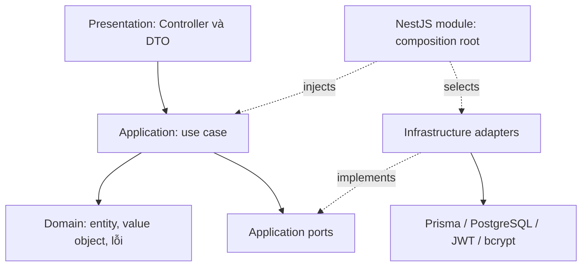
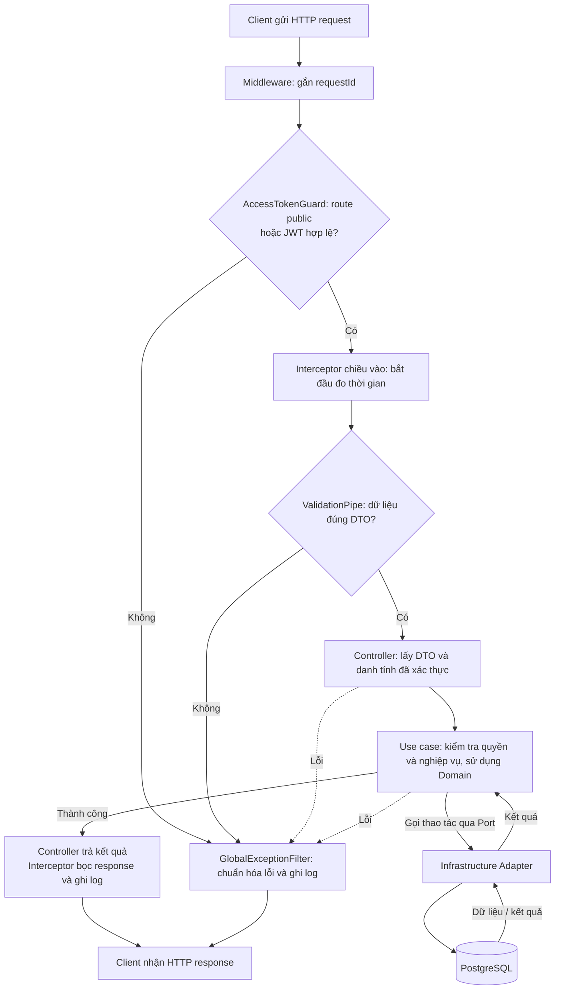
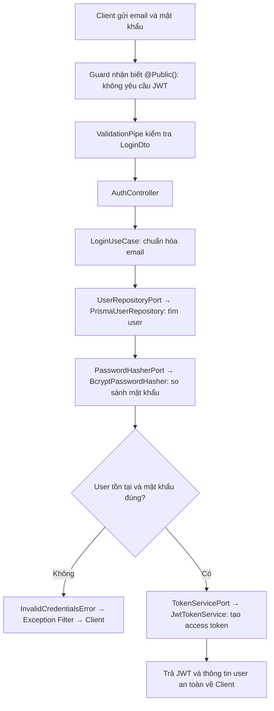
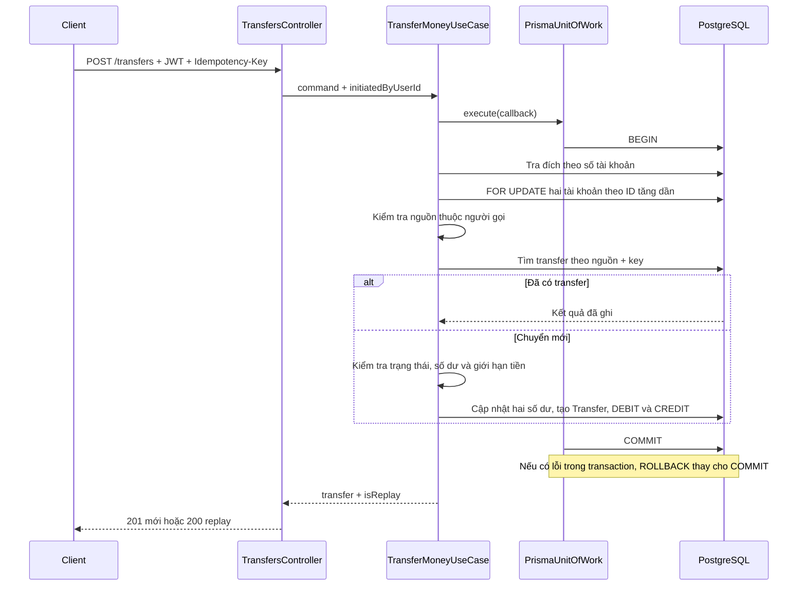
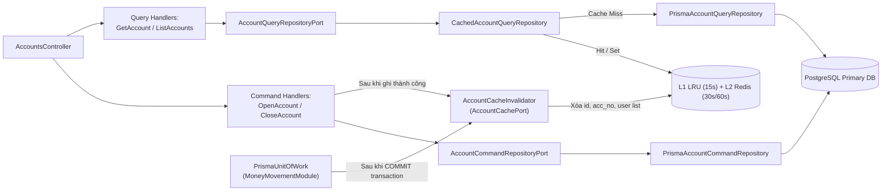

# Kiến trúc hệ thống

[Mục lục](README.md) · [README dự án](../../README.md)

## 1. Kiểu kiến trúc

SA Bank Account là **modular monolith**: một ứng dụng NestJS chứa ba module nghiệp vụ chính (`identity`, `accounts`, `money-movement`) cùng module giám sát vận hành (`health`), dùng chung PostgreSQL và bộ nhớ đệm đa tầng (L1 In-Memory LRU + L2 Redis). Bên trong ứng dụng, mã nguồn áp dụng các nguyên tắc của **Clean Architecture**, **Hexagonal Architecture (Ports & Adapters)** và **CQRS (Command Query Responsibility Segregation)**:

– **Clean Architecture:** phân chia presentation, application, domain và infrastructure. Use case, command/query handler và domain không import NestJS hay Prisma; module NestJS kết nối các thành phần bằng dependency injection.  
– **Hexagonal Architecture:** controller HTTP tiếp nhận yêu cầu và gọi use case hoặc handler; các port định nghĩa hợp đồng mà nghiệp vụ cần, còn adapter hiện thực hợp đồng bằng Prisma, Redis/LRU, Piscina bcrypt hoặc JWT. Ví dụ, `UnitOfWorkPort` được triển khai bởi `PrismaUnitOfWork`, và `OutboxHealthIndicatorPort` được triển khai bởi `PrismaOutboxHealthIndicator`.  
– **CQRS trên phân hệ Accounts:** tách biệt hoàn toàn nhánh ghi (`OpenAccountHandler`, `CloseAccountHandler` thao tác trực tiếp trên Primary DB để đảm bảo tính nhất quán mạnh) và nhánh đọc (`GetAccountQueryHandler`, `ListAccountsQueryHandler` trả `AccountReadModel` phẳng qua tầng Cache-Aside đa tầng L1/L2).  

Các module được triển khai cùng ứng dụng và sử dụng chung database. Khi chuyển khoản, việc cập nhật số dư nguồn, số dư đích và ghi lịch sử được thực hiện trong cùng một database transaction, sau đó tự động vô hiệu hóa cache của các tài khoản bị biến động số dư ngay sau khi commit thành công.

## 2. Ranh giới module

| Module | Thành phần chính | Trách nhiệm |
| --- | --- | --- |
| identity | AuthController; RegisterUserUseCase; LoginUseCase; BcryptPasswordHasher (Piscina) | Đăng ký, xác thực mật khẩu qua Worker Pool, cấp JWT |
| accounts | AccountsController; Open/CloseAccountHandler (Command); List/GetAccountQueryHandler (Query); AccountCacheInvalidator | Quản lý vòng đời tài khoản theo CQRS, tra cứu qua Multi-level Cache và quản lý xóa cache |
| money-movement | TransactionController; TransfersController; Deposit/Withdraw/Transfer/GetTransactionHistoryUseCase | Điều phối nạp, rút, chuyển khoản, lịch sử và xóa cache tài khoản sau commit |
| health | HealthController; HealthService; PrismaOutboxHealthIndicator | Giám sát sức khỏe toàn diện (PostgreSQL, Redis, Piscina Worker Pool, Outbox lag) |
| common | Money, AccessTokenGuard, RateLimiterGuard, TrafficLoadService, filter, pipe, interceptor, logger | Quy ước dùng chung, bảo mật, giới hạn tần suất và quan sát hệ thống xuyên module |
| infrastructure/prisma | PrismaService, PrismaModule | Cung cấp kết nối DB và Prisma Client |
| infrastructure/cache | MultiLevelCacheService, CacheModule | Cung cấp bộ nhớ đệm đa tầng L1 (LRU RAM) + L2 (Redis) |

[AppModule](../../src/app.module.ts) ghép các module nghiệp vụ và giám sát cùng các module cấu hình, quan sát, cache và kết nối database. Việc tra cứu tài khoản hoặc xóa cache liên module giữa `money-movement` và `accounts` được thực hiện qua các port được export (`ACCOUNTS_FACADE`, `ACCOUNT_CACHE`).

## 3. Cấu trúc đầy đủ thư mục src

Cây dưới đây liệt kê toàn bộ thư mục và file trong `src`, bao gồm các file `index.ts`.

```text
src/
├── common/  # Thành phần dùng chung
│   ├── concurrency/  # Theo dõi tải lưu lượng đồng thời
│   │   ├── concurrency.module.ts
│   │   ├── index.ts
│   │   └── traffic-load.service.ts
│   ├── config/  # Cấu hình ứng dụng và biến môi trường
│   │   ├── app.config.ts
│   │   ├── database.config.ts
│   │   ├── env.schema.ts
│   │   ├── index.ts
│   │   ├── jwt.config.ts
│   │   └── redis.config.ts
│   ├── domain/  # Money và lỗi dùng chung
│   │   ├── errors/
│   │   │   ├── app.error.ts
│   │   │   ├── common.errors.ts
│   │   │   └── index.ts
│   │   └── value-objects/
│   │       ├── index.ts
│   │       └── money.value-object.ts
│   ├── http/  # Xử lý HTTP và tài liệu Swagger
│   │   ├── filters/
│   │   │   ├── global-exception.filter.ts
│   │   │   └── index.ts
│   │   ├── interceptors/
│   │   │   ├── http-logging.interceptor.ts
│   │   │   ├── index.ts
│   │   │   └── response-envelope.interceptor.ts
│   │   ├── middleware/
│   │   │   ├── index.ts
│   │   │   ├── request-id.middleware.ts
│   │   │   └── traffic-load.middleware.ts
│   │   ├── pipes/
│   │   │   ├── index.ts
│   │   │   └── validation-pipe.factory.ts
│   │   └── swagger/
│   │       ├── response.schemas.ts
│   │       └── swagger.config.ts
│   ├── observability/  # Logging và giám sát Event Loop
│   │   ├── event-loop-monitor.service.ts
│   │   ├── index.ts
│   │   ├── logger.service.ts
│   │   └── observability.module.ts
│   └── security/  # Guard, decorator, rate limit và port xác thực
│       ├── decorators/
│       │   ├── current-user.decorator.ts
│       │   ├── index.ts
│       │   ├── public.decorator.ts
│       │   └── rate-limit.decorator.ts
│       ├── guards/
│       │   ├── access-token.guard.ts
│       │   ├── index.ts
│       │   └── rate-limiter.guard.ts
│       ├── ports/
│       │   ├── index.ts
│       │   └── token-service.port.ts
│       └── rate-limit/
│           └── redis-token-bucket.service.ts
├── infrastructure/  # Hạ tầng dùng chung
│   ├── cache/  # Bộ nhớ đệm đa tầng L1 LRU + L2 Redis
│   │   ├── cache.module.ts
│   │   └── multi-level-cache.service.ts
│   └── prisma/  # Prisma Client và kết nối database
│       ├── index.ts
│       ├── prisma.module.ts
│       └── prisma.service.ts
├── modules/  # Các module nghiệp vụ và vận hành
│   ├── accounts/  # Quản lý tài khoản theo mô hình CQRS
│   │   ├── application/
│   │   │   ├── commands/
│   │   │   │   ├── close-account.command.ts
│   │   │   │   ├── index.ts
│   │   │   │   └── open-account.command.ts
│   │   │   ├── ports/
│   │   │   │   ├── account-cache.port.ts
│   │   │   │   ├── account-command.repository.port.ts
│   │   │   │   ├── account-query.repository.port.ts
│   │   │   │   ├── accounts.facade.ts
│   │   │   │   └── index.ts
│   │   │   └── queries/
│   │   │       ├── account.read-model.ts
│   │   │       ├── get-account.query.ts
│   │   │       ├── index.ts
│   │   │       └── list-accounts.query.ts
│   │   ├── domain/
│   │   │   ├── entities/
│   │   │   │   ├── bank-account.entity.ts
│   │   │   │   └── index.ts
│   │   │   ├── enums/
│   │   │   │   ├── account-status.ts
│   │   │   │   ├── account-type.ts
│   │   │   │   └── index.ts
│   │   │   └── errors/
│   │   │       ├── account-has-balance.error.ts
│   │   │       └── account-not-found.error.ts
│   │   ├── infrastructure/
│   │   │   ├── adapters/
│   │   │   │   └── account-lookup.facade.ts
│   │   │   └── persistence/
│   │   │       ├── account-cache.invalidator.ts
│   │   │       ├── cached-account-query.repository.ts
│   │   │       ├── index.ts
│   │   │       ├── prisma-account-command.repository.ts
│   │   │       └── prisma-account-query.repository.ts
│   │   ├── presentation/
│   │   │   └── http/
│   │   │       ├── dto/
│   │   │       │   ├── account-id-params.dto.ts
│   │   │       │   ├── account-response.schema.ts
│   │   │       │   ├── list-accounts-query.dto.ts
│   │   │       │   └── open-account.dto.ts
│   │   │       ├── accounts.controller.ts
│   │   │       └── index.ts
│   │   └── accounts.module.ts
│   ├── health/  # Giám sát sức khỏe hệ thống toàn diện
│   │   ├── application/
│   │   │   ├── ports/
│   │   │   │   └── outbox-health.port.ts
│   │   │   └── health.service.ts
│   │   ├── infrastructure/
│   │   │   └── prisma-outbox-health.indicator.ts
│   │   ├── presentation/
│   │   │   └── http/
│   │   │       ├── dto/
│   │   │       │   └── health-response.schema.ts
│   │   │       └── health.controller.ts
│   │   └── health.module.ts
│   ├── identity/  # Danh tính và xác thực
│   │   ├── application/
│   │   │   ├── ports/
│   │   │   │   ├── index.ts
│   │   │   │   ├── password-hasher.port.ts
│   │   │   │   └── user.repository.port.ts
│   │   │   └── use-cases/
│   │   │       ├── index.ts
│   │   │       ├── login.use-case.ts
│   │   │       └── register-user.use-case.ts
│   │   ├── domain/
│   │   │   ├── entities/
│   │   │   │   ├── index.ts
│   │   │   │   └── user.entity.ts
│   │   │   ├── enums/
│   │   │   │   └── index.ts
│   │   │   ├── errors/
│   │   │   │   ├── identity.errors.ts
│   │   │   │   └── index.ts
│   │   │   └── value-objects/
│   │   │       └── index.ts
│   │   ├── infrastructure/
│   │   │   ├── mail/
│   │   │   │   └── index.ts
│   │   │   ├── persistence/
│   │   │   │   ├── index.ts
│   │   │   │   └── prisma-user.repository.ts
│   │   │   └── security/
│   │   │       ├── bcrypt-password-hasher.ts
│   │   │       ├── bcrypt.worker.ts
│   │   │       ├── index.ts
│   │   │       └── jwt-token.service.ts
│   │   ├── presentation/
│   │   │   ├── http/
│   │   │   │   ├── dto/
│   │   │   │   │   ├── auth-response.schema.ts
│   │   │   │   │   ├── index.ts
│   │   │   │   │   ├── login.dto.ts
│   │   │   │   │   └── register.dto.ts
│   │   │   │   ├── auth.controller.ts
│   │   │   │   └── index.ts
│   │   │   └── index.ts
│   │   └── identity.module.ts
│   ├── money-movement/  # Giao dịch tiền và lịch sử
│   │   ├── application/
│   │   │   ├── ports/
│   │   │   │   ├── accounts.port.ts
│   │   │   │   ├── index.ts
│   │   │   │   ├── transaction-query.port.ts
│   │   │   │   └── unit-of-work.port.ts
│   │   │   └── use-cases/
│   │   │       ├── deposit-money.use-case.ts
│   │   │       ├── get-transaction-history.use-case.ts
│   │   │       ├── index.ts
│   │   │       ├── resolve-recipient.use-case.ts
│   │   │       ├── transfer-money.use-case.ts
│   │   │       └── withdraw-money.use-case.ts
│   │   ├── domain/
│   │   │   ├── entities/
│   │   │   │   └── index.ts
│   │   │   ├── enums/
│   │   │   │   └── index.ts
│   │   │   ├── errors/
│   │   │   │   ├── index.ts
│   │   │   │   └── money-movement.errors.ts
│   │   │   └── value-objects/
│   │   │       └── index.ts
│   │   ├── infrastructure/
│   │   │   ├── adapters/
│   │   │   │   └── accounts.adapter.ts
│   │   │   └── persistence/
│   │   │       ├── index.ts
│   │   │       ├── prisma-transaction-query.ts
│   │   │       └── prisma-unit-of-work.ts
│   │   ├── presentation/
│   │   │   └── http/
│   │   │       ├── dto/
│   │   │       │   ├── create-transaction.dto.ts
│   │   │       │   ├── list-transactions-query.dto.ts
│   │   │       │   ├── money-movement-response.schema.ts
│   │   │       │   └── transfer-money.dto.ts
│   │   │       ├── index.ts
│   │   │       ├── transactions.controller.ts
│   │   │       └── transfers.controller.ts
│   │   └── money-movement.module.ts
│   └── staff-support/  # Khung thư mục hỗ trợ nhân viên
│       ├── application/
│       │   ├── ports/
│       │   │   └── index.ts
│       │   └── use-cases/
│       │       └── index.ts
│       ├── infrastructure/
│       │   └── persistence/
│       │       └── index.ts
│       └── presentation/
│           └── http/
│               └── index.ts
├── app.module.ts  # Ghép module và đăng ký guard toàn cục
└── main.ts  # Khởi động HTTP, validation, filter và Swagger
```

Trong mỗi module nghiệp vụ, các thư mục có vai trò sau:

| Thư mục | Vai trò |
| --- | --- |
| `presentation/http` | Controller, DTO đầu vào và schema response cho Swagger |
| `application/use-cases` | Điều phối từng thao tác nghiệp vụ (trong `identity`, `money-movement`) |
| `application/commands` | Command Handlers xử lý nhánh ghi nhất quán mạnh (trong `accounts`) |
| `application/queries` | Query Handlers và Read Model phẳng tối ưu cho nhánh đọc & cache (trong `accounts`) |
| `application/ports` | Hợp đồng truy cập dữ liệu, cache và dịch vụ mà use case / handler sử dụng |
| `domain` | Entity, enum, value object và lỗi nghiệp vụ |
| `infrastructure/persistence` | Repository (Command/Query), Cache-Aside decorator, cache invalidator và unit of work |
| `infrastructure/adapters` | Các implementation kết nối qua port hoặc facade |
| `infrastructure/security` | Implementation JWT và Piscina bcrypt worker pool của module `identity` |

`staff-support` chứa khung thư mục và các file `index.ts`; `AppModule` đăng ký ba module nghiệp vụ `identity`, `accounts`, `money-movement` cùng module giám sát `health`. Các file `index.ts` dùng để tập hợp export hoặc giữ vị trí cho nhóm mã tương ứng.

## 4. Trách nhiệm từng lớp



Presentation nhận body/path/query, kiểm tra định dạng, lấy `user.sub` từ JWT và ánh xạ kết quả ra HTTP. Application quyết định ai được thao tác, điều kiện số dư/trạng thái, thứ tự thao tác và replay. Domain chứa khái niệm chung như `Money` và lỗi nghiệp vụ. Infrastructure hiện thực các port bằng công nghệ cụ thể.

Ví dụ, `TransferMoneyUseCase` nhận `UnitOfWorkPort`; `MoneyMovementModule` cung cấp `PrismaUnitOfWork` qua token `UNIT_OF_WORK`. Unit test sử dụng fake để kiểm tra nghiệp vụ. Integration test sử dụng PostgreSQL để kiểm tra row lock và constraint.

`Money` ở `common/domain` vì cả tài khoản và giao dịch đều dùng nó. Nó dùng `bigint`, bất biến khi cộng/trừ và serialize thành string. Giới hạn 18 chữ số được kiểm tra bởi DTO/use case và cột DB; bản thân `Money` không áp giới hạn này cho mọi phép toán.

## 5. Luồng HTTP và bảo mật

### 5.1. Request đi từ đâu đến đâu?



Sơ đồ áp dụng cho các API controller của ứng dụng. Nhánh PostgreSQL minh họa adapter dữ liệu; adapter bcrypt hoặc JWT thực hiện tác vụ riêng, không cần đọc/ghi database.

1. **Middleware:** gắn request ID để liên kết response và log; đồng thời `TrafficLoadMiddleware` đếm số request nghiệp vụ đang xử lý song song (tự động bỏ qua các đường dẫn `/auth/*`, `/health` và `/api/docs` để probe giám sát hoặc luồng xác thực không làm nhiễu bộ đếm tải).
2. **Guard:** `RateLimiterGuard` kiểm tra hạn ngạch Token Bucket trên Redis (nếu route khai báo `@RateLimit`), sau đó `AccessTokenGuard` xác thực Bearer token trước khi chạy phương thức controller. Các route gắn `@Public()` (`/auth/register`, `/auth/login`, `/health`) được bỏ qua yêu cầu JWT.
3. **Interceptor chiều vào:** bắt đầu đo thời gian xử lý sau guard, trước validation pipe.
4. **Validation pipe:** chuyển đổi dữ liệu theo cấu hình DTO, kiểm tra ràng buộc và từ chối field ngoài hợp đồng.
5. **Controller:** nhận dữ liệu đã kiểm tra, lấy danh tính đã xác thực và gọi use case. Controller có thể kiểm tra thêm header, như `Idempotency-Key` của chuyển tiền.
6. **Use case:** điều phối chức năng, sử dụng Domain và gọi các thao tác được định nghĩa bởi Port. Adapter được inject sẽ thực thi các thao tác này.
7. **Chiều trả về:** kết quả đi về controller; response interceptor bọc envelope và HTTP logging interceptor ghi request thành công. Nếu có lỗi được ném ra, exception filter chuẩn hóa response lỗi và ghi log.

Use case có thể đọc dữ liệu qua adapter để kiểm tra quyền và nghiệp vụ rồi mới ghi dữ liệu. Domain và Port không phải hai dịch vụ được gọi đồng thời. Port là interface, không có một bước xử lý runtime riêng; NestJS DI nối use case với adapter khi khởi tạo ứng dụng.

Filter chỉ ánh xạ lỗi sang HTTP, không chịu trách nhiệm rollback. Khi callback transaction thất bại, Prisma rollback trước khi lỗi được trả về client. Lỗi guard xảy ra trước interceptor nên không đi qua phần đo thời gian của HTTP logging interceptor.

Lỗi nghiệp vụ kế thừa `AppError`, khai báo `errorCode` và `httpStatus`. Exception filter sử dụng các thuộc tính này để tạo HTTP response.

### 5.2. Bảo mật được kiểm tra ở đâu?

| Điểm kiểm tra | Câu hỏi cần trả lời | Cách thực hiện hiện tại |
| --- | --- | --- |
| Xác thực — guard | Người gọi là ai? | Đọc Bearer JWT, xác minh bằng `TokenServicePort`, gắn payload vào `request.user`; thiếu/sai/hết hạn token trả `401` |
| Kiểm tra đầu vào — pipe và DTO | Dữ liệu có đúng cấu trúc và ràng buộc không? | Kiểm tra body/path/query theo DTO; từ chối field ngoài hợp đồng; controller kiểm tra header cần thiết |
| Phân quyền — use case | Người gọi có được thao tác tài khoản này không? | So sánh chủ tài khoản với user ID lấy từ JWT đã xác minh |
| Quy tắc nghiệp vụ — use case và Domain | Thao tác có hợp lệ không? | Kiểm tra trạng thái tài khoản, số tiền, số dư và giới hạn tiền |
| Nhất quán dữ liệu — use case và adapter | Cập nhật đồng thời hoặc gửi lại có làm sai dữ liệu không? | Transaction, row lock, idempotency và constraint DB; chi tiết ở mục 6–7 |

**Xác thực không thay thế phân quyền.** User A có JWT hợp lệ sẽ qua guard, nhưng không được chuyển tiền từ tài khoản của user B. `TransfersController` lấy `initiatedByUserId` từ `user.sub`, không nhận danh tính này tùy ý từ body. `TransferMoneyUseCase` kiểm tra chủ tài khoản nguồn trước khi trả kết quả replay hoặc thực hiện chuyển mới. Nguồn không tồn tại hoặc không thuộc người gọi đều trả `404`.

Các cơ chế transaction, row lock và idempotency bảo vệ tính đúng đắn của giao dịch; chúng không thay thế kiểm tra JWT và quyền sở hữu. Khi thử lại chuyển tiền, client cần gửi cùng key và payload; hiện tại use case chưa đối chiếu toàn bộ payload với giao dịch cũ khi tìm thấy cùng key.

### 5.3. Luồng đăng nhập: bcrypt và JWT nằm ở đâu?



Sơ đồ đăng nhập lược bỏ middleware và interceptor đã mô tả ở mục 5.1. Khi email không tồn tại, use case vẫn so sánh mật khẩu với một hash giả để giảm khác biệt thời gian xử lý; email không tồn tại và mật khẩu sai cùng trả một loại lỗi đăng nhập.

Bcrypt băm mật khẩu khi đăng ký và kiểm tra mật khẩu khi đăng nhập. Các request được bảo vệ sau đó dùng JWT, không chạy bcrypt lại trên mỗi request. Client gửi `Authorization: Bearer <accessToken>`; guard xác minh token trước khi controller được thực thi.

### 5.4. Mã nguồn để đối chiếu

– [main.ts](../../src/main.ts): đăng ký middleware, interceptor, validation pipe và exception filter.  
– [AppModule](../../src/app.module.ts): đăng ký `AccessTokenGuard` toàn cục bằng `APP_GUARD`.  
– [AccessTokenGuard](../../src/common/security/guards/access-token.guard.ts): xác thực JWT và xử lý route public.  
– [ValidationPipe](../../src/common/http/pipes/validation-pipe.factory.ts): cấu hình kiểm tra đầu vào.  
– [TransfersController](../../src/modules/money-movement/presentation/http/transfers.controller.ts) và [TransferMoneyUseCase](../../src/modules/money-movement/application/use-cases/transfer-money.use-case.ts): lấy danh tính, kiểm tra quyền và điều phối chuyển tiền.  
– [LoginUseCase](../../src/modules/identity/application/use-cases/login.use-case.ts): kiểm tra mật khẩu qua port và yêu cầu tạo JWT.  
– [BcryptPasswordHasher](../../src/modules/identity/infrastructure/security/bcrypt-password-hasher.ts) và [JwtTokenService](../../src/modules/identity/infrastructure/security/jwt-token.service.ts): adapter bảo mật.  

## 6. Luồng chuyển khoản



Các mũi tên từ use case tới DB biểu diễn thao tác qua transaction context do unit of work cung cấp; use case không import Prisma. Khóa theo cùng thứ tự ID giảm nguy cơ deadlock khi A→B và B→A chạy đồng thời. Các request ghi vào cùng tài khoản chờ khóa được giải phóng trước khi tiếp tục.

Đường ghi chuyển khoản sử dụng trực tiếp các port trong unit of work để thao tác hai tài khoản trong cùng transaction; nó không gọi HTTP của module accounts. Truy vấn lịch sử dùng `TransactionQueryPort` riêng, không cần khóa ghi tài khoản.

## 7. Cơ chế bảo đảm nhất quán

| Tình huống | Cơ chế |
| --- | --- |
| Hai lần rút cùng số dư | Khóa dòng, đọc số dư trong transaction rồi kiểm tra |
| Lỗi giữa trừ nguồn và cộng đích | Toàn bộ cập nhật và lịch sử rollback |
| Retry transfer | Khóa dòng nguồn kết hợp unique `(source, key)` và đọc kết quả cũ |
| Đóng tài khoản đồng thời nạp tiền | UPDATE có điều kiện owner, ACTIVE và balance = 0; nếu không cập nhật được thì đọc lại |
| Mở tài khoản có tiền ban đầu | Tạo account và OPENING_DEPOSIT trong một transaction |

`PrismaUnitOfWork` sử dụng isolation level mặc định của database kết hợp row lock. Lỗi trong callback làm transaction rollback và được chuyển tới tầng xử lý lỗi; unit of work không tự động thực hiện lại transaction.

Lịch sử giao dịch được ghi và đọc qua API; API không cung cấp thao tác sửa/xóa lịch sử. Quyền thay đổi dữ liệu bằng SQL trực tiếp thuộc phạm vi quản trị database. Chi tiết quy tắc ghi dữ liệu nằm trong [database](02-database.md) và [nghiệp vụ](04-business-rules.md).

## 8. Mô hình CQRS và đồng bộ Cache trên Module Accounts

Để tối ưu hóa đồng thời **tốc độ đọc lưu lượng lớn** và **tính nhất quán tuyệt đối khi thay đổi trạng thái tài khoản**, phân hệ `accounts` tách rời hoàn toàn nhánh ghi (Command) và nhánh đọc (Query):



### 8.1. Nhánh Ghi (Command Side — Strong Consistency)
– **Thành phần:** [OpenAccountHandler](../../src/modules/accounts/application/commands/open-account.command.ts) và [CloseAccountHandler](../../src/modules/accounts/application/commands/close-account.command.ts) phụ thuộc vào `AccountCommandRepositoryPort` (hiện thực bởi [PrismaAccountCommandRepository](../../src/modules/accounts/infrastructure/persistence/prisma-account-command.repository.ts)).  
– **Đặc tính:** Tuyệt đối **không đọc dữ liệu qua Cache**. Mọi kiểm tra số dư bằng 0 khi đóng tài khoản (`closeIfZeroBalance`) hay khởi tạo tài khoản kèm `OPENING_DEPOSIT` đều thao tác trực tiếp với Primary PostgreSQL bằng Domain Entity `BankAccount` và Value Object `Money`, ngăn chặn triệt để rủi ro quyết định nghiệp vụ dựa trên bản ghi cache cũ (*stale read*).  

### 8.2. Nhánh Đọc (Query Side — Flat Read Model & Multi-level Cache)
– **Thành phần:** [GetAccountQueryHandler](../../src/modules/accounts/application/queries/get-account.query.ts), [ListAccountsQueryHandler](../../src/modules/accounts/application/queries/list-accounts.query.ts) và [AccountLookupFacade](../../src/modules/accounts/infrastructure/adapters/account-lookup.facade.ts) phụ thuộc vào `AccountQueryRepositoryPort`.  
– **Read Model phẳng:** [AccountReadModel](../../src/modules/accounts/application/queries/account.read-model.ts) biểu diễn sẵn `currentBalance` dạng `string` và `createdAt`/`closedAt` dạng chuỗi ISO 8601. Nhờ đó, luồng đọc không tốn chi phí cấp phát `Money` (`bigint`) hay `Date` khi serialize/deserialize qua cache.  
– **Cache-Aside Đa tầng:** [CachedAccountQueryRepository](../../src/modules/accounts/infrastructure/persistence/cached-account-query.repository.ts) đóng vai trò Decorator bọc ngoài [PrismaAccountQueryRepository](../../src/modules/accounts/infrastructure/persistence/prisma-account-query.repository.ts):  
  1. Tra cứu **L1 In-Memory LRU Cache** (tối đa 1000 keys, TTL tối đa 15 giây ngay trong RAM tiến trình Node.js).  
  2. Nếu miss L1, tra cứu **L2 Redis Cache** (TTL 60 giây cho chi tiết tài khoản theo ID/số tài khoản; 30 giây cho trang danh sách tài khoản) và nạp ngược lên L1. Nếu Redis gặp sự cố, `MultiLevelCacheService` tự động suy giảm mềm (*graceful degradation*) về L1 + DB mà không làm gián đoạn request.  
  3. Nếu miss cả hai tầng, truy vấn PostgreSQL với mệnh đề `SELECT` chỉ chiếu đúng các cột của `AccountReadModel`. Cấu trúc này cũng cho phép điều hướng riêng `PrismaAccountQueryRepository` sang Read Replica trong tương lai mà không chạm tới nhánh Command.  

### 8.3. Xóa Cache Sau Commit Liên Module (Post-Commit Cache Invalidation)
Một thách thức kinh điển khi cache tài khoản là các giao dịch nạp tiền, rút tiền và chuyển khoản lại diễn ra bên trong module `money-movement`. Hệ thống giải quyết triệt để nguy cơ *stale balance* như sau:
– `AccountsModule` export port `ACCOUNT_CACHE` ([AccountCacheInvalidator](../../src/modules/accounts/infrastructure/persistence/account-cache.invalidator.ts)) sang `MoneyMovementModule`.  
– Trong [PrismaUnitOfWork](../../src/modules/money-movement/infrastructure/persistence/prisma-unit-of-work.ts), mỗi khi khóa hoặc cập nhật tài khoản trong `prisma.$transaction`, context ghi nhận thông tin định danh (`id`, `userId`, `accountNumber`) vào `knownAccounts` và đánh dấu các tài khoản thực sự đổi số dư vào `touchedAccountIds`.  
– **Chỉ sau khi khối `$transaction` đã `COMMIT` thành công xuống PostgreSQL**, `PrismaUnitOfWork` mới kích hoạt `accountCache.invalidateAccount(...)` để xóa đồng bộ cả khóa chi tiết (`accounts:id:{id}`), khóa tra cứu số tài khoản (`accounts:acc_no:{accountNumber}`) và toàn bộ phân trang danh sách của chủ tài khoản (`accounts:user:{userId}:*`) trên cả L1 và L2. Nếu transaction bị rollback do lỗi nghiệp vụ, cache không bị can thiệp sai lệch.  

## 9. Kiến trúc Giám sát Sức khỏe Toàn diện (`HealthModule`)

Module `health` cung cấp endpoint vận hành `GET /api/v1/health` theo kiến trúc Ports & Adapters nhằm phục vụ Docker `HEALTHCHECK`, Load Balancer và hệ thống giám sát tập trung:

| Thành phần kiểm tra | Cách thức đo lường | Timeout | Ngưỡng suy giảm / lỗi | Tác động tới HTTP Status |
| --- | --- | --- | --- | --- |
| **PostgreSQL** (`postgres`) | Truy vấn `SELECT 1` qua `PrismaService`, đo `latencyMs` | `2000ms` | Lỗi kết nối hoặc quá hạn $\rightarrow$ `DOWN` | **Sống còn:** Trả `503 SERVICE_UNAVAILABLE` |
| **Piscina Pool** (`piscina`) | Đọc metrics từ `BcryptPasswordHasher` (`inFlight`, `queued`, `maxThreads`, `maxQueue`, `currentLimit`) | Tức thời (RAM) | `isDestroyed` $\rightarrow$ `DOWN`; `queued >= maxQueue` $\rightarrow$ `DEGRADED` | `DOWN` trả `503`; `DEGRADED` giữ `200 OK` |
| **Redis Cache** (`redis`) | Lệnh `PING` qua `MultiLevelCacheService.ping()`, đo `latencyMs` | `1500ms` | Mất kết nối hoặc timeout $\rightarrow$ `DEGRADED` | **Phụ trợ:** Giữ `200 OK` (`status: "DEGRADED"`) |
| **Outbox Lag** (`outbox`) | `OutboxHealthIndicatorPort` kiểm tra bảng Outbox, đếm `pendingCount` và tuổi bản ghi cũ nhất `lagMs` | `1500ms` | `lagMs > OUTBOX_MAX_LAG_MS` (mặc định `30000ms`) hoặc timeout $\rightarrow$ `DEGRADED` | **Phụ trợ:** Giữ `200 OK` (`status: "DEGRADED"`) |

– **Kiểm tra song song có giới hạn thời gian:** [HealthService](../../src/modules/health/application/health.service.ts) thực thi đồng thời cả 4 phép kiểm tra bằng `Promise.all` kết hợp `Promise.race` và `timer.unref()`, đảm bảo tổng thời gian phản hồi của `/health` luôn bị chặn trên ngay cả khi mạng DB hoặc Redis bị treo.  
– **Tương thích linh hoạt cho Transactional Outbox:** [PrismaOutboxHealthIndicator](../../src/modules/health/infrastructure/prisma-outbox-health.indicator.ts) truy vấn `information_schema.columns` để tự động nhận diện bảng Outbox (`outbox_events`, `outbox_messages`, `outbox`). Khi schema chưa tạo bảng Outbox, indicator trả mặc định `{ status: "OK", pendingCount: 0, lagMs: 0 }`; khi bảng tồn tại, nó tự động đo số bản ghi chưa phát hành và độ trễ tính bằng mili-giây.  
– **Chống khởi động lại dây chuyền (Anti-Cascading Restart):** Khi Redis bảo trì hoặc hàng đợi Piscina đầy tạm thời dưới tải đăng nhập đột biến, ứng dụng vẫn xử lý chính xác các giao dịch ngân hàng cốt lõi. Việc trả HTTP `200` kèm `status: "DEGRADED"` giúp hệ thống cảnh báo sớm cho đội vận hành mà không khiến Docker hay Kubernetes giết container đang khỏe mạnh.  

## 10. Điểm bắt đầu đọc mã

– [Bootstrap HTTP](../../src/main.ts) và [AppModule](../../src/app.module.ts).  
– [AccountsModule](../../src/modules/accounts/accounts.module.ts): cấu hình DI tách biệt Command Handlers, Query Handlers và Cache-Aside.  
– [CachedAccountQueryRepository](../../src/modules/accounts/infrastructure/persistence/cached-account-query.repository.ts), [PrismaAccountCommandRepository](../../src/modules/accounts/infrastructure/persistence/prisma-account-command.repository.ts) và [PrismaAccountQueryRepository](../../src/modules/accounts/infrastructure/persistence/prisma-account-query.repository.ts): hiện thực CQRS trên phân hệ tài khoản.  
– [MoneyMovementModule](../../src/modules/money-movement/money-movement.module.ts) và [TransferMoneyUseCase](../../src/modules/money-movement/application/use-cases/transfer-money.use-case.ts): điều phối chuyển tiền.  
– [PrismaUnitOfWork](../../src/modules/money-movement/infrastructure/persistence/prisma-unit-of-work.ts): transaction context, khóa dòng và xóa cache tài khoản sau commit.  
– [HealthService](../../src/modules/health/application/health.service.ts) và [PrismaOutboxHealthIndicator](../../src/modules/health/infrastructure/prisma-outbox-health.indicator.ts): kiểm tra sức khỏe toàn diện hệ thống.  
